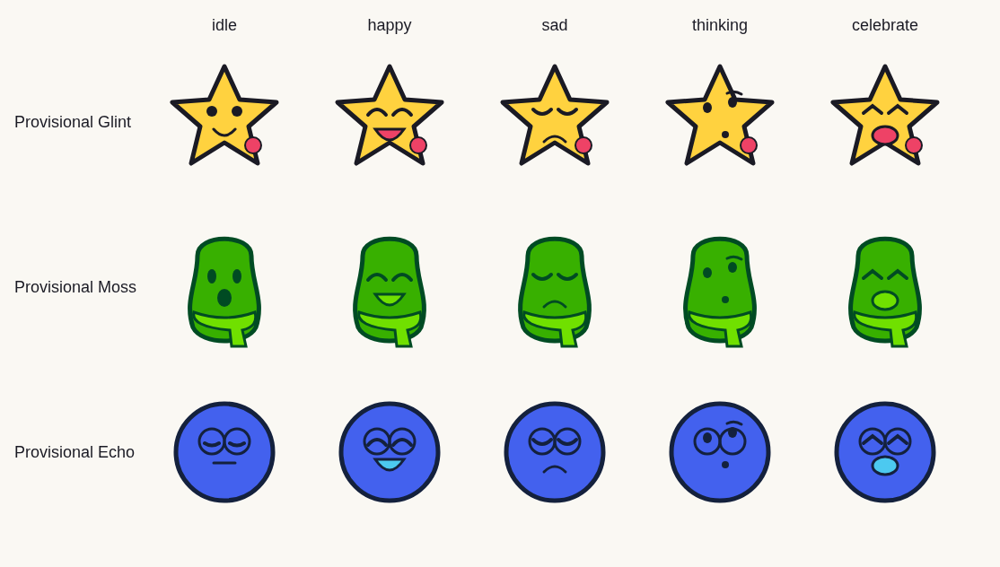

# Default cast: character review sheet (E17-02, #40)

Rendered with the real `original-v1` rig (`compileRigSvg` in `apps/client/src/features/characters/rig.ts`) from the specs in `fixtures.ts`. Regenerate with `mise run client:character-sheet`; output is deterministic.

Files: `sheet.svg`, `sheet-dark.svg` (dark background), `sheet.png`, and one SVG per character and expression (`<name>-<expression>.svg`).

## Characters

| Character         | Shape, eyes, mouth  | Body      | Accent    | Outline   | Accessories |
| ----------------- | ------------------- | --------- | --------- | --------- | ----------- |
| Provisional Glint | star, round, smile  | `#FFD23F` | `#EE4266` | `#1A1A24` | badge       |
| Provisional Moss  | bean, oval, open    | `#38B000` | `#70E000` | `#004B23` | scarf       |
| Provisional Echo  | round, sleepy, line | `#4361EE` | `#4CC9F0` | `#14213D` | glasses     |

## Reduced motion

The rig emits static SVG with no animation of its own, so every expression is already a still pose. With reduced motion on (`data-motion="reduce"` or `prefers-reduced-motion: reduce`), the lesson player and cast stage only switch off CSS animation and transition (for example the avatar transform and opacity fades). The code has no separate "static idle only" pose: reduced motion does not swap the art, it only removes motion.

## Review notes

- Expressions read differently on Glint and Moss. On Echo the sleepy eyes are similar across idle, happy, sad and celebrate, so the mouth carries most of the difference.
- Glint and Moss "thinking" eyes are asymmetric by design (one raised brow).
- Echo's glasses sit over the eyes and overlap them slightly.

## Questions for the owner

1. Approve the art as is, or request changes (say which character and expression)?
2. What are the final names to replace "Provisional Glint", "Provisional Moss" and "Provisional Echo"?
3. Confirm that none of the three resembles a third-party character or likeness.
