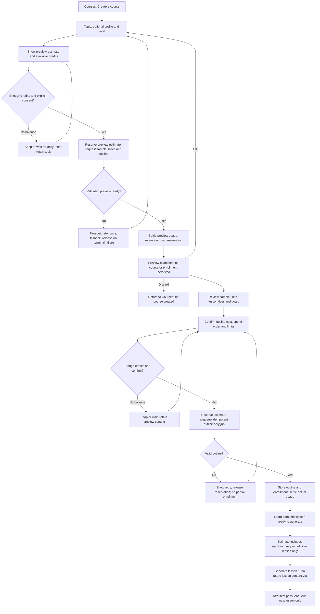
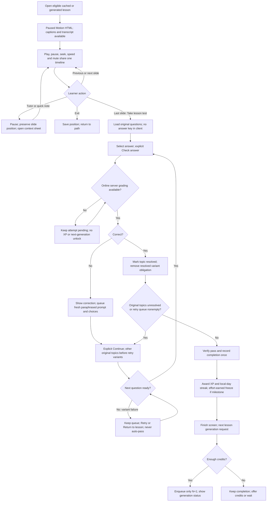
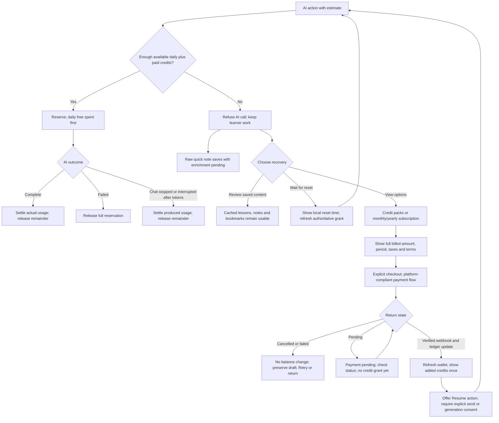
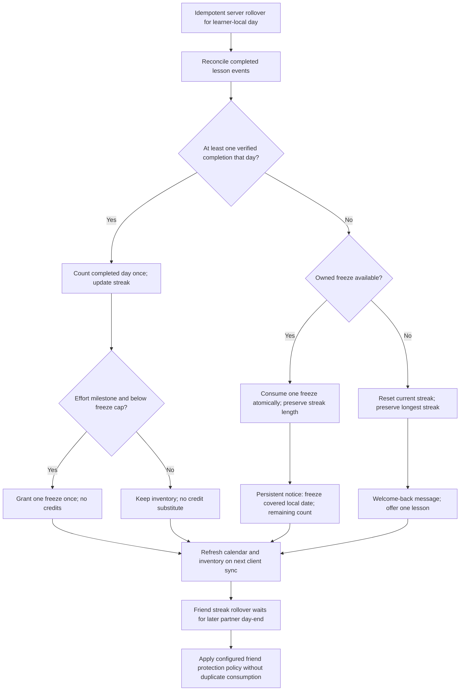

# Interaction flows

These are design contracts for subsequent implementation. The prototype exercises the lesson/test and illustrative purchase boundaries with authored fixtures; production grading, costs and rollover are server-owned. Every AI path preserves work, enforces configured caps and uses the existing timeout/retry/fallback policy. No flow grants credits for effort.

## Course creation: preview, outline, then gated lessons

Back/Cancel preserves the local draft but does not claim server persistence of a discarded preview. A price estimate that changes requires renewed confirmation. The API refuses gated or unaffordable generation before calling the engine. Duplicate submits/reconnects attach to the same job and reservation.

## Lesson, test and retry variants

Resolved-topic progress is not a decreasing percentage or a lives counter. A wrong variant queues another fresh variant. When no other topic remains, the persistent correction and Continue separate the retry from the mistake. Replaying a completed lesson cannot duplicate XP or generation. Server completion, not merely reaching the end of slides, is authoritative.

## Credits exhaustion, purchase and return

Only a verified idempotent webhook posts purchased credits. Query flags, browser closure and elapsed time never prove payment. Daily credits expire at the learner's local day-end and are one shared pool sized for approximately 3 note enrichments plus 5–8 chat messages, not fixed separate counters. E12 supplies actual offers and platform billing rules. The prototype cannot charge money.

## Automatic streak freeze application

A freeze preserves a missed day; it does not add XP or increase the streak. No manual activation or credit purchase is designed. Friend-streak protection/consumption is an open E6 policy question: final copy and inventory behavior require that decision. Offline views show last verified state, not optimistic freeze use. Timezone changes must reconcile through server policy; client midnight timers never finalize the result.
