# E1–E17 implementation tickets

134 tickets. The authoritative ticket bodies, acceptance and ordered tests are in [tickets.json](tickets.json); this file is the matching dependency view. E0 is merged and is not a blocker. No GitHub issues are created by this plan.

Each AFK ticket is one reviewable PR and one agent session: S ≈ 1–2 hours, M ≈ half a day, L ≈ one day. E7 has 14 tickets and E15 has 13 because native billing channels and moderation/recovery require separate bounded PRs. Most HITL tickets produce an owner decision or redacted provisioning evidence, so those decisions can happen early. E7-12/E7-13 are native-billing implementation PRs with executable TDD tests plus a final owner/device verification step. Downstream tickets list the decisions and implementations they need. Tests are written e2e → integration → unit, then implementation. Test paths in JSON are proposed locations in existing area suites, not a claim those files already exist.

## Scope, precedence and handoff

- Read the base capability together with its linked deltas. `product-rules-v1` replaces 80% grading, whole-test retries, effort credits and purchased freezes. All topics resolve correctly; first-try perfection remains the XP bonus input. One learner/day freeze protection is reused across all friend pairs.
- `pricing-config` identifies the E12 catalogue as already approved; monetary assumptions and governance still listed as open questions have separate HITL gates. `monetization-model` defines eligible free actions, oldest eligible paid spending, no paid expiry, separate audio components and stricter launch retry/USD limits. E4-06 explicitly resolves the remaining pool-exhaustion conflict rather than inventing a paid retry. E1-05/E11-03 resolve 14-day general versus 35-day financial snapshot retention; live seven-year records never expire with snapshots.
- E0 includes Go health/preview transport, learners and append-only legacy ledger, River dummy jobs, Rust provider/RPC/eval scaffolds, MSW course data and static Motion HTML playback. It does not supply auth, persistent courses, grading, real billing, consent enforcement or scheduled backups. Existing decimal OpenRouter aliases are verified in E10-03/E12-07; stale business notes do not justify redoing that config fix.
- E3-01 consumes migrated synthetic lesson fixtures and a real authorized manifest API; E4 later becomes its production producer. This breaks the apparent E3/E4 cycle. E12-01 is a read-only config tracer before reservation consumers. E13 integrates existing tokens/design artifacts rather than rewriting them. E15-01 is a private screened-draft tracer before public links and enrollment.
- New implementation with only a base spec (especially auth) must first create and strictly validate its scoped OpenSpec change inside that ticket. Existing deltas are linked in JSON; this planning commit edits no OpenSpec. Every proto ticket implements both API and engine in the same PR.
- Data-owning tickets update the actual inventory at `docs/data-inventory.md` (some change task lists incorrectly say `docs/business/data-inventory.md`). Add focused backup/restore/deletion checks with each persisted feature; do not wait for a later broad hardening ticket.
- AI merges require feature cases in the pinned Hugging Face dataset (owner setup E10-01), recorded fixtures and `mise run engine:eval`. Existing scaffold mock evaluation supports early slices; E10 upgrades the harness and E10-06 provides the reusable live promotion gate. Feature-specific live cases are added and run by each feature PR; E10 is not a substitute for them.
- Fixture-driven auth/payment/speech implementation does not consume real secrets. Live auth E1-10, dataset/provider setup E10-01, billing policy/keys E7-05, native owner/device verification E7-12/E7-13 and desktop/web pilot E7-14, catalogue E12-08, narration E14-05 and infrastructure E11-07 provide owner gates. Desktop/web sales require E7-14 after pricing activation, financial restore/reconciliation, live eval gates and reviewed infrastructure rollout. Apple and Google sales separately require their HITL E7-12/E7-13 owner/device acceptance plus the same pricing, recovery and rollout gates; mobile does not block web.
- No public marketplace release before HITL E15-13, which depends on E15-11 deletion/restore, E15-12 rights/age/domain policy, notifications, verified billing/evals and reviewed infrastructure. E15-07 remains behind its release flag until then. Paid marketplace courses/revenue sharing, fork updates/rejoining and speculative future lesson generation are out of scope.
- E17-01 is the default-cast tracer after E3-01 Motion HTML manifest playback: provisional original fixtures stay behind a flag and are unblocked by E17 HITL work. E17-02 is the single owner gate for ADR 0010, a new character_create pricing version, limits and final original cast art; E17-03 needs the rig/limits/art answer and E17-04 additionally needs the price answer. Free editing/selection does not require an active paid key; the remaining integrations inherit approved Character versions rather than waiting on a separate owner gate. E17 uses E10-03’s stricter launch attempt/USD ceiling within its retry/fallback upper bounds, and retains E14 narration rights/quality and E15 publication/recovery gates. No image generation, standalone Character sharing or retroactive Lesson regeneration is added.
- Implement only the specified narrow behavior per ticket; use mocks for upstream optional integrations and feature flags for not-yet-approved live paths. Follow focused mise checks, draft PRs and one PR per ticket when this plan is executed. This deliverable is local planning and the requested commit only; it does not open/merge PRs or remove this worktree.

## Design revision 2026-11-09

Commit 11bb044 (PR #50) supersedes earlier visual/form assumptions: green tokens/theme.css and semantic secondary, info, credit, streak and lime roles; guided setup/course brief; editable sample outline with Apply/Discard chat diffs; desktop-first layouts with mobile parity. Every UI ticket cites its matching canvas boards in acceptance. Older form/read-only wording in screens.md is superseded by its revision paragraph and the design-system delta; feature tickets reconcile capability/proto deltas before coding.

Changed: E1-01, E1-02, E1-03, E1-04, E1-05, E1-06, E1-07, E1-08, E1-09, E1-10, E2-01, E2-02, E2-03, E2-04, E2-05, E3-01, E3-02, E3-03, E3-04, E3-05, E3-06, E4-01, E4-02, E4-03, E4-04, E4-05, E4-06, E4-07, E5-01, E5-02, E5-03, E5-04, E5-05, E5-06, E6-01, E6-02, E6-03, E6-04, E6-05, E6-06, E6-07, E7-01, E7-02, E7-03, E7-04, E7-05, E7-06, E7-07, E7-08, E7-09, E7-10, E7-12, E7-13, E7-14, E8-01, E8-02, E8-03, E8-04, E8-05, E9-01, E9-02, E9-03, E9-04, E9-05, E12-01, E12-02, E12-03, E12-06, E13-01, E13-02, E13-03, E13-04, E13-05, E13-06, E14-01, E14-02, E14-03, E14-04, E14-05, E14-06, E15-01, E15-02, E15-03, E15-04, E15-05, E15-06, E15-07, E15-08, E15-09, E15-10, E15-11, E15-12, E15-13, E16-01, E16-02, E16-03, E16-04, E16-05, E16-06, E16-07, E16-08, E17-01, E17-02, E17-03, E17-04, E17-05, E17-06, E17-07, E17-08, E17-09.

New: E1-11, E2-06, E2-07, E2-08, E12-09, E12-10.

E1-03 owns confirmed profile persistence and the form fallback; E1-11 adds setup chat. E2-06 supplies the brief, E2-01 the paid preview, E2-07 the free editor, E2-08 proposed paid chat diffs, and E2-02 creates from the edited snapshot. E12-09 blocks only E12-10 price activation; development uses explicitly unapproved config/fixtures and production flags stay disabled. The new setup_chat/course_brief_chat/outline_chat_change keys do not alter the approved seed or ADR 0011’s separate outline_replan=55 decision.

## E1 — Accounts and learner profile

| ID | Title | Kind | Size | Blocked by |
| --- | --- | --- | --- | --- |
| E1-01 | Confirm the authentication contract | HITL | S | — |
| E1-02 | Sign in with an email code | AFK | L | E1-01, E13-01 |
| E1-03 | Confirm learner context with a form fallback | AFK | M | E1-02, E13-03 |
| E1-04 | Rotate and revoke sessions | AFK | M | E1-02 |
| E1-05 | Approve privacy and retention policy | HITL | S | — |
| E1-06 | Persist settings and analytics consent | AFK | M | E1-03, E13-02 |
| E1-07 | Export and delete account data | AFK | L | E1-04, E1-05, E1-06 |
| E1-08 | Sign in through Google OAuth | AFK | M | E1-04 |
| E1-09 | Sign in through Apple OAuth | AFK | M | E1-04 |
| E1-10 | Provision live authentication credentials | HITL | S | E1-02, E1-08, E1-09, E1-05 |
| E1-11 | Guide onboarding through a confirmed setup chat | AFK | L | E1-03, E1-06, E12-02, E13-03 |

## E2 — Course creation

| ID | Title | Kind | Size | Blocked by |
| --- | --- | --- | --- | --- |
| E2-01 | Confirm a course brief and preview without enrolling | AFK | L | E1-03, E1-06, E7-03, E2-06 |
| E2-02 | Create a course from the confirmed edited outline | AFK | L | E2-01, E2-07, E2-08 |
| E2-03 | Switch courses and override course level | AFK | M | E2-02 |
| E2-04 | Recover generation and remove courses | AFK | M | E2-02 |
| E2-05 | Offer the approved shared onboarding demo | AFK | M | E2-01, E3-01, E12-08 |
| E2-06 | Clarify a course brief before paid preview | AFK | L | E1-11, E1-06, E12-02, E13-03 |
| E2-07 | Edit the sample outline with accessible undo | AFK | M | E2-01, E13-03 |
| E2-08 | Propose outline-chat changes as an Apply or Discard diff | AFK | L | E2-07, E7-03, E12-02 |

## E3 — Lesson player

| ID | Title | Kind | Size | Blocked by |
| --- | --- | --- | --- | --- |
| E3-01 | Play an authorized lesson manifest | AFK | L | E2-03, E13-03 |
| E3-02 | Control and resume slide playback | AFK | M | E3-01 |
| E3-03 | Cache opened lessons and preload slides | AFK | M | E3-02 |
| E3-04 | Synchronize offline playback progress once | AFK | M | E3-03 |
| E3-05 | Provide accessible static lesson recovery | AFK | M | E3-02, E13-04 |
| E3-06 | Download an entitled offline course library | AFK | M | E3-03, E7-07 |

## E4 — Gated generation and lesson tests

| ID | Title | Kind | Size | Blocked by |
| --- | --- | --- | --- | --- |
| E4-01 | Generate and pass the first gated lesson | AFK | L | E2-03, E3-01, E7-03 |
| E4-02 | Generate topic-linked retry pools with lessons | AFK | L | E4-01 |
| E4-03 | Offer spaced retries and topic recaps | AFK | M | E4-02 |
| E4-04 | Resume and replay lesson test sessions | AFK | M | E4-03, E3-04 |
| E4-05 | Prepare only the next lesson after a pass | AFK | M | E4-01 |
| E4-06 | Resolve retry-pool exhaustion pricing | HITL | S | — |
| E4-07 | Handle exhausted retry pools without blocking tests | AFK | M | E4-03, E4-06, E7-03 |

## E5 — Gamification

| ID | Title | Kind | Size | Blocked by |
| --- | --- | --- | --- | --- |
| E5-01 | Award completion XP and daily goals | AFK | M | E4-01, E1-06 |
| E5-02 | Track learner-local streak days | AFK | M | E5-01 |
| E5-03 | Earn and auto-apply streak freezes | AFK | M | E5-02 |
| E5-04 | Rank weekly leagues from durable XP | AFK | M | E5-01, E5-02 |
| E5-05 | Finalize leagues and restore gamification state | AFK | M | E5-03, E5-04 |
| E5-06 | Expose paid learning analytics and history exports | AFK | M | E5-05, E7-07 |

## E6 — Social and friend streaks

| ID | Title | Kind | Size | Blocked by |
| --- | --- | --- | --- | --- |
| E6-01 | Choose a unique public username | AFK | M | E1-03, E5-02, E1-05 |
| E6-02 | Rename and find learners with privacy controls | AFK | M | E6-01 |
| E6-03 | Accept friend requests and remove connections | AFK | M | E6-02 |
| E6-04 | Block learners and restrict social visibility | AFK | M | E6-03 |
| E6-05 | Define shared-day labels across timezones | HITL | S | — |
| E6-06 | Grow and protect shared friend streaks | AFK | L | E6-04, E6-05, E5-03 |
| E6-07 | Nudge friends and clean up social state | AFK | M | E6-06 |

## E7 — Credits and billing

| ID | Title | Kind | Size | Blocked by |
| --- | --- | --- | --- | --- |
| E7-01 | Read an auditable credit wallet | AFK | M | E1-03, E1-06, E12-01 |
| E7-02 | Grant and expire eligible daily credits | AFK | L | E7-01, E12-02 |
| E7-03 | Reserve and settle versioned AI quotes | AFK | L | E7-02, E12-02 |
| E7-04 | Show priced purchase and exhaustion recovery | AFK | M | E7-03, E12-03, E13-03 |
| E7-05 | Approve billing policy and provision provider accounts | HITL | S | — |
| E7-06 | Fulfill Stripe credit packs exactly once | AFK | L | E7-04 |
| E7-07 | Activate monthly subscriptions from paid invoices | AFK | L | E7-06 |
| E7-08 | Schedule funded annual allowances monthly | AFK | M | E7-07 |
| E7-09 | Reconcile renewals and subscription changes | AFK | M | E7-07, E7-08 |
| E7-10 | Apply source-attributed refunds and disputes | AFK | L | E7-06, E7-09, E1-05, E7-05 |
| E7-11 | Reconcile and restore financial operations | AFK | L | E7-10, E11-03, E11-05 |
| E7-12 | Purchase and restore through Apple billing | HITL | L | E7-09, E7-10, E7-05, E7-11, E12-08, E10-06, E11-07 |
| E7-13 | Purchase and restore through Google billing | HITL | L | E7-09, E7-10, E7-05, E7-11, E12-08, E10-06, E11-07 |
| E7-14 | Verify Stripe and approve the paid pilot | HITL | S | E7-11, E12-08, E11-07, E10-06 |

## E8 — Tutor chat

| ID | Title | Kind | Size | Blocked by |
| --- | --- | --- | --- | --- |
| E8-01 | Stream a quoted course tutor reply | AFK | L | E4-05, E7-03, E1-06 |
| E8-02 | Stop and recover partially streamed replies | AFK | L | E8-01 |
| E8-03 | Retrieve full-course context within tutor limits | AFK | M | E8-01 |
| E8-04 | Ask the tutor from a paused lesson sheet | AFK | M | E8-02, E3-02, E13-03 |
| E8-05 | Delete tutor threads and save replies as notes | AFK | M | E8-04, E9-01 |

## E9 — Quick notes and bookmarks

| ID | Title | Kind | Size | Blocked by |
| --- | --- | --- | --- | --- |
| E9-01 | Save raw quick notes before enrichment | AFK | M | E3-01, E7-02, E1-06, E13-03 |
| E9-02 | Enrich notes with grounded summaries and tags | AFK | L | E9-01, E7-03 |
| E9-03 | Resume pending enrichment when credits arrive | AFK | M | E9-02 |
| E9-04 | Find review and export quick notes | AFK | M | E9-02 |
| E9-05 | Bookmark lessons and exact slides | AFK | M | E3-04, E7-01, E1-06 |

## E10 — Evals and model reliability

| ID | Title | Kind | Size | Blocked by |
| --- | --- | --- | --- | --- |
| E10-01 | Provision the golden dataset and evaluation secrets | HITL | S | — |
| E10-02 | Score each AI task with critical checks | AFK | M | E2-01 |
| E10-03 | Bound and verify model routing failures | AFK | M | E2-01, E7-03 |
| E10-04 | Mirror pinned golden revisions for offline recovery | AFK | M | E10-02 |
| E10-05 | Expose reliability and AI cost dashboards | AFK | M | E10-02, E10-03, E11-04 |
| E10-06 | Gate AI promotion on reproducible live samples | AFK | M | E10-02, E10-03, E10-04, E10-05, E10-01 |

## E11 — Operations and recovery

| ID | Title | Kind | Size | Blocked by |
| --- | --- | --- | --- | --- |
| E11-01 | Back up a synthetic database through the worker | AFK | L | — |
| E11-02 | Approve recovery credentials and storage capability | HITL | S | — |
| E11-03 | Enforce isolated backup retention and object protection | AFK | M | E11-01, E11-02, E1-05 |
| E11-04 | Trace requests workers and operational alerts | AFK | M | E11-01, E1-06 |
| E11-05 | Run automated anonymized restore drills | AFK | M | E11-03, E11-04 |
| E11-06 | Configure Railway environments and release gates | AFK | M | E11-04, E11-02 |
| E11-07 | Provision environment secrets and approve rollout | HITL | S | E11-05, E11-06 |

## E12 — Pricing config implementation

| ID | Title | Kind | Size | Blocked by |
| --- | --- | --- | --- | --- |
| E12-01 | Serve the approved pricing seed end to end | AFK | L | — |
| E12-02 | Quote actions with immutable pricing versions | AFK | M | E12-01, E1-02 |
| E12-03 | Render cached prices without client literals | AFK | M | E12-02, E13-01 |
| E12-04 | Confirm pricing governance and notice policy | HITL | S | — |
| E12-05 | Draft and approve audited pricing changes | AFK | L | E12-02, E12-04, E1-04 |
| E12-06 | Schedule and roll back pricing without deployment | AFK | M | E12-05 |
| E12-07 | Verify external mappings and catalogue economics | AFK | M | E12-05, E10-02 |
| E12-08 | Map real products and activate the launch catalogue | HITL | S | E12-06, E12-07, E7-05, E1-05 |
| E12-09 | Decide setup clarifying and outline-chat pricing | HITL | S | — |
| E12-10 | Activate approved setup and outline-chat prices | AFK | M | E12-09, E12-06, E1-11, E2-06, E2-08 |

## E13 — Design implementation

| ID | Title | Kind | Size | Blocked by |
| --- | --- | --- | --- | --- |
| E13-01 | Apply the green theme and semantic roles to course cards | AFK | M | — |
| E13-02 | Implement desktop-first shells with mobile parity | AFK | M | E13-01 |
| E13-03 | Share guided-chat summary outline and sheet components | AFK | M | E13-01 |
| E13-04 | Support localized copy and reduced motion | AFK | M | E13-02, E13-03 |
| E13-05 | Approve final brand assets and usability evidence | HITL | S | — |
| E13-06 | Install approved identity and optional feedback | AFK | M | E13-04, E13-05 |

## E14 — Slide narration

| ID | Title | Kind | Size | Blocked by |
| --- | --- | --- | --- | --- |
| E14-01 | Synthesize and play one narrated slide | AFK | L | E3-02, E4-01, E7-03 |
| E14-02 | Deduplicate and recover narration assets | AFK | M | E14-01 |
| E14-03 | Synchronize audio captions and offline playback | AFK | M | E14-02, E3-03, E3-05 |
| E14-04 | Connect bounded ElevenLabs synthesis | AFK | M | E14-02 |
| E14-05 | Approve live voices and narration quality | HITL | S | E14-04, E10-06 |
| E14-06 | Select entitled voices with explicit synthesis quotes | AFK | M | E14-03, E14-05, E7-07 |

## E15 — Course sharing and marketplace

| ID | Title | Kind | Size | Blocked by |
| --- | --- | --- | --- | --- |
| E15-01 | Preview a screened publication draft | AFK | L | E2-03, E6-04, E12-02, E4-02 |
| E15-02 | Publish revocable links with public previews | AFK | M | E15-01, E15-12 |
| E15-03 | Enroll a pinned copy and reuse lessons for free | AFK | M | E15-02, E4-04 |
| E15-04 | Generate missing published lessons for the learner | AFK | M | E15-03, E4-05, E7-03 |
| E15-05 | Republish versions and preserve copy progress | AFK | M | E15-03 |
| E15-06 | Invite friends to courses with notifications | AFK | L | E15-03, E6-07, E15-12 |
| E15-07 | Browse a filtered public marketplace | AFK | M | E15-03, E15-12 |
| E15-08 | Rate and screen course reviews | AFK | L | E15-07 |
| E15-09 | Report targets and hide reported courses | AFK | M | E15-07, E15-08 |
| E15-10 | Moderate publications and one-time appeals | AFK | L | E15-09, E15-12 |
| E15-11 | Retain shared assets through deletion and recovery | AFK | L | E15-04, E15-05, E15-10, E11-05 |
| E15-12 | Approve sharing rights and marketplace policy | HITL | S | — |
| E15-13 | Approve the moderated marketplace pilot | HITL | S | E15-11, E15-12, E15-06, E7-14, E10-06, E11-07 |

## E16 — Course steering

| ID | Title | Kind | Size | Blocked by |
| --- | --- | --- | --- | --- |
| E16-01 | Steer a future private lesson end to end | AFK | L | E4-05, E7-03, E16-04 |
| E16-02 | Edit and scope course instructions safely | AFK | M | E16-01 |
| E16-03 | Harden steering against prompt injection | AFK | M | E16-02, E10-02 |
| E16-04 | Confirm steering limits and optional extensions | HITL | S | — |
| E16-05 | Fork a published copy before steering | AFK | M | E16-02, E15-03, E15-04 |
| E16-06 | Approve a versioned outline replan price | HITL | S | — |
| E16-07 | Quote and propose an immutable remaining-outline diff | AFK | L | E16-02, E16-06, E12-06 |
| E16-08 | Confirm discard and expire outline proposals | AFK | M | E16-07, E16-05 |

## E17 — Custom characters

| ID | Title | Kind | Size | Blocked by |
| --- | --- | --- | --- | --- |
| E17-01 | Play a default-cast Motion HTML tracer | AFK | L | E3-01 |
| E17-02 | Approve character architecture pricing limits and original art | HITL | S | — |
| E17-03 | Edit private characters and choose a Course Cast | AFK | L | E17-01, E10-02, E10-03 |
| E17-04 | Create and regenerate a quoted private character | AFK | L | E17-03, E17-02, E7-03, E12-06, E10-02, E10-03 |
| E17-05 | Pin Course Casts through generated Lesson playback | AFK | L | E17-03, E4-02, E4-05, E3-03, E3-05, E10-02, E10-03 |
| E17-06 | React to authoritative Lesson answers without changing grading | AFK | M | E17-05, E4-03, E10-02 |
| E17-07 | Pin safe Character personas for Tutor chat turns | AFK | L | E17-05, E8-01, E8-02, E8-05, E10-02, E10-03 |
| E17-08 | Narrate pinned speakers with allowlisted Character voices | AFK | M | E17-05, E14-03, E14-06, E7-03, E10-02, E10-03 |
| E17-09 | Publish immutable Character snapshots with safe lifecycle | AFK | L | E17-05, E17-08, E15-01, E15-03, E15-04, E15-05, E15-11, E16-05, E11-05, E10-02, E10-03 |

## Full ticket dependency DAG

Arrows run from blocker to dependent. HITL nodes are shaded; subgraphs group epics, not additional dependencies.

```mermaid
graph LR
  subgraph E1["E1: Accounts and learner profile"]
    E1_01["E1-01: Confirm the authentication contract"]
    E1_02["E1-02: Sign in with an email code"]
    E1_03["E1-03: Confirm learner context with a form fallback"]
    E1_04["E1-04: Rotate and revoke sessions"]
    E1_05["E1-05: Approve privacy and retention policy"]
    E1_06["E1-06: Persist settings and analytics consent"]
    E1_07["E1-07: Export and delete account data"]
    E1_08["E1-08: Sign in through Google OAuth"]
    E1_09["E1-09: Sign in through Apple OAuth"]
    E1_10["E1-10: Provision live authentication credentials"]
    E1_11["E1-11: Guide onboarding through a confirmed setup chat"]
  end
  subgraph E2["E2: Course creation"]
    E2_01["E2-01: Confirm a course brief and preview without enrolling"]
    E2_02["E2-02: Create a course from the confirmed edited outline"]
    E2_03["E2-03: Switch courses and override course level"]
    E2_04["E2-04: Recover generation and remove courses"]
    E2_05["E2-05: Offer the approved shared onboarding demo"]
    E2_06["E2-06: Clarify a course brief before paid preview"]
    E2_07["E2-07: Edit the sample outline with accessible undo"]
    E2_08["E2-08: Propose outline-chat changes as an Apply or Discard diff"]
  end
  subgraph E3["E3: Lesson player"]
    E3_01["E3-01: Play an authorized lesson manifest"]
    E3_02["E3-02: Control and resume slide playback"]
    E3_03["E3-03: Cache opened lessons and preload slides"]
    E3_04["E3-04: Synchronize offline playback progress once"]
    E3_05["E3-05: Provide accessible static lesson recovery"]
    E3_06["E3-06: Download an entitled offline course library"]
  end
  subgraph E4["E4: Gated generation and lesson tests"]
    E4_01["E4-01: Generate and pass the first gated lesson"]
    E4_02["E4-02: Generate topic-linked retry pools with lessons"]
    E4_03["E4-03: Offer spaced retries and topic recaps"]
    E4_04["E4-04: Resume and replay lesson test sessions"]
    E4_05["E4-05: Prepare only the next lesson after a pass"]
    E4_06["E4-06: Resolve retry-pool exhaustion pricing"]
    E4_07["E4-07: Handle exhausted retry pools without blocking tests"]
  end
  subgraph E5["E5: Gamification"]
    E5_01["E5-01: Award completion XP and daily goals"]
    E5_02["E5-02: Track learner-local streak days"]
    E5_03["E5-03: Earn and auto-apply streak freezes"]
    E5_04["E5-04: Rank weekly leagues from durable XP"]
    E5_05["E5-05: Finalize leagues and restore gamification state"]
    E5_06["E5-06: Expose paid learning analytics and history exports"]
  end
  subgraph E6["E6: Social and friend streaks"]
    E6_01["E6-01: Choose a unique public username"]
    E6_02["E6-02: Rename and find learners with privacy controls"]
    E6_03["E6-03: Accept friend requests and remove connections"]
    E6_04["E6-04: Block learners and restrict social visibility"]
    E6_05["E6-05: Define shared-day labels across timezones"]
    E6_06["E6-06: Grow and protect shared friend streaks"]
    E6_07["E6-07: Nudge friends and clean up social state"]
  end
  subgraph E7["E7: Credits and billing"]
    E7_01["E7-01: Read an auditable credit wallet"]
    E7_02["E7-02: Grant and expire eligible daily credits"]
    E7_03["E7-03: Reserve and settle versioned AI quotes"]
    E7_04["E7-04: Show priced purchase and exhaustion recovery"]
    E7_05["E7-05: Approve billing policy and provision provider accounts"]
    E7_06["E7-06: Fulfill Stripe credit packs exactly once"]
    E7_07["E7-07: Activate monthly subscriptions from paid invoices"]
    E7_08["E7-08: Schedule funded annual allowances monthly"]
    E7_09["E7-09: Reconcile renewals and subscription changes"]
    E7_10["E7-10: Apply source-attributed refunds and disputes"]
    E7_11["E7-11: Reconcile and restore financial operations"]
    E7_12["E7-12: Purchase and restore through Apple billing"]
    E7_13["E7-13: Purchase and restore through Google billing"]
    E7_14["E7-14: Verify Stripe and approve the paid pilot"]
  end
  subgraph E8["E8: Tutor chat"]
    E8_01["E8-01: Stream a quoted course tutor reply"]
    E8_02["E8-02: Stop and recover partially streamed replies"]
    E8_03["E8-03: Retrieve full-course context within tutor limits"]
    E8_04["E8-04: Ask the tutor from a paused lesson sheet"]
    E8_05["E8-05: Delete tutor threads and save replies as notes"]
  end
  subgraph E9["E9: Quick notes and bookmarks"]
    E9_01["E9-01: Save raw quick notes before enrichment"]
    E9_02["E9-02: Enrich notes with grounded summaries and tags"]
    E9_03["E9-03: Resume pending enrichment when credits arrive"]
    E9_04["E9-04: Find review and export quick notes"]
    E9_05["E9-05: Bookmark lessons and exact slides"]
  end
  subgraph E10["E10: Evals and model reliability"]
    E10_01["E10-01: Provision the golden dataset and evaluation secrets"]
    E10_02["E10-02: Score each AI task with critical checks"]
    E10_03["E10-03: Bound and verify model routing failures"]
    E10_04["E10-04: Mirror pinned golden revisions for offline recovery"]
    E10_05["E10-05: Expose reliability and AI cost dashboards"]
    E10_06["E10-06: Gate AI promotion on reproducible live samples"]
  end
  subgraph E11["E11: Operations and recovery"]
    E11_01["E11-01: Back up a synthetic database through the worker"]
    E11_02["E11-02: Approve recovery credentials and storage capability"]
    E11_03["E11-03: Enforce isolated backup retention and object protection"]
    E11_04["E11-04: Trace requests workers and operational alerts"]
    E11_05["E11-05: Run automated anonymized restore drills"]
    E11_06["E11-06: Configure Railway environments and release gates"]
    E11_07["E11-07: Provision environment secrets and approve rollout"]
  end
  subgraph E12["E12: Pricing config implementation"]
    E12_01["E12-01: Serve the approved pricing seed end to end"]
    E12_02["E12-02: Quote actions with immutable pricing versions"]
    E12_03["E12-03: Render cached prices without client literals"]
    E12_04["E12-04: Confirm pricing governance and notice policy"]
    E12_05["E12-05: Draft and approve audited pricing changes"]
    E12_06["E12-06: Schedule and roll back pricing without deployment"]
    E12_07["E12-07: Verify external mappings and catalogue economics"]
    E12_08["E12-08: Map real products and activate the launch catalogue"]
    E12_09["E12-09: Decide setup clarifying and outline-chat pricing"]
    E12_10["E12-10: Activate approved setup and outline-chat prices"]
  end
  subgraph E13["E13: Design implementation"]
    E13_01["E13-01: Apply the green theme and semantic roles to course cards"]
    E13_02["E13-02: Implement desktop-first shells with mobile parity"]
    E13_03["E13-03: Share guided-chat summary outline and sheet components"]
    E13_04["E13-04: Support localized copy and reduced motion"]
    E13_05["E13-05: Approve final brand assets and usability evidence"]
    E13_06["E13-06: Install approved identity and optional feedback"]
  end
  subgraph E14["E14: Slide narration"]
    E14_01["E14-01: Synthesize and play one narrated slide"]
    E14_02["E14-02: Deduplicate and recover narration assets"]
    E14_03["E14-03: Synchronize audio captions and offline playback"]
    E14_04["E14-04: Connect bounded ElevenLabs synthesis"]
    E14_05["E14-05: Approve live voices and narration quality"]
    E14_06["E14-06: Select entitled voices with explicit synthesis quotes"]
  end
  subgraph E15["E15: Course sharing and marketplace"]
    E15_01["E15-01: Preview a screened publication draft"]
    E15_02["E15-02: Publish revocable links with public previews"]
    E15_03["E15-03: Enroll a pinned copy and reuse lessons for free"]
    E15_04["E15-04: Generate missing published lessons for the learner"]
    E15_05["E15-05: Republish versions and preserve copy progress"]
    E15_06["E15-06: Invite friends to courses with notifications"]
    E15_07["E15-07: Browse a filtered public marketplace"]
    E15_08["E15-08: Rate and screen course reviews"]
    E15_09["E15-09: Report targets and hide reported courses"]
    E15_10["E15-10: Moderate publications and one-time appeals"]
    E15_11["E15-11: Retain shared assets through deletion and recovery"]
    E15_12["E15-12: Approve sharing rights and marketplace policy"]
    E15_13["E15-13: Approve the moderated marketplace pilot"]
  end
  subgraph E16["E16: Course steering"]
    E16_01["E16-01: Steer a future private lesson end to end"]
    E16_02["E16-02: Edit and scope course instructions safely"]
    E16_03["E16-03: Harden steering against prompt injection"]
    E16_04["E16-04: Confirm steering limits and optional extensions"]
    E16_05["E16-05: Fork a published copy before steering"]
    E16_06["E16-06: Approve a versioned outline replan price"]
    E16_07["E16-07: Quote and propose an immutable remaining-outline diff"]
    E16_08["E16-08: Confirm discard and expire outline proposals"]
  end
  subgraph E17["E17: Custom characters"]
    E17_01["E17-01: Play a default-cast Motion HTML tracer"]
    E17_02["E17-02: Approve character architecture pricing limits and original art"]
    E17_03["E17-03: Edit private characters and choose a Course Cast"]
    E17_04["E17-04: Create and regenerate a quoted private character"]
    E17_05["E17-05: Pin Course Casts through generated Lesson playback"]
    E17_06["E17-06: React to authoritative Lesson answers without changing grading"]
    E17_07["E17-07: Pin safe Character personas for Tutor chat turns"]
    E17_08["E17-08: Narrate pinned speakers with allowlisted Character voices"]
    E17_09["E17-09: Publish immutable Character snapshots with safe lifecycle"]
  end
  classDef hitl fill:#fff0d6,stroke:#774617,color:#38250c
  class E1_01,E1_05,E1_10,E4_06,E6_05,E7_05,E7_12,E7_13,E7_14,E10_01,E11_02,E11_07,E12_04,E12_08,E12_09,E13_05,E14_05,E15_12,E15_13,E16_04,E16_06,E17_02 hitl
    E1_01 --> E1_02
    E13_01 --> E1_02
    E1_02 --> E1_03
    E13_03 --> E1_03
    E1_02 --> E1_04
    E1_03 --> E1_06
    E13_02 --> E1_06
    E1_04 --> E1_07
    E1_05 --> E1_07
    E1_06 --> E1_07
    E1_04 --> E1_08
    E1_04 --> E1_09
    E1_02 --> E1_10
    E1_08 --> E1_10
    E1_09 --> E1_10
    E1_05 --> E1_10
    E1_03 --> E1_11
    E1_06 --> E1_11
    E12_02 --> E1_11
    E13_03 --> E1_11
    E1_03 --> E2_01
    E1_06 --> E2_01
    E7_03 --> E2_01
    E2_06 --> E2_01
    E2_01 --> E2_02
    E2_07 --> E2_02
    E2_08 --> E2_02
    E2_02 --> E2_03
    E2_02 --> E2_04
    E2_01 --> E2_05
    E3_01 --> E2_05
    E12_08 --> E2_05
    E1_11 --> E2_06
    E1_06 --> E2_06
    E12_02 --> E2_06
    E13_03 --> E2_06
    E2_01 --> E2_07
    E13_03 --> E2_07
    E2_07 --> E2_08
    E7_03 --> E2_08
    E12_02 --> E2_08
    E2_03 --> E3_01
    E13_03 --> E3_01
    E3_01 --> E3_02
    E3_02 --> E3_03
    E3_03 --> E3_04
    E3_02 --> E3_05
    E13_04 --> E3_05
    E3_03 --> E3_06
    E7_07 --> E3_06
    E2_03 --> E4_01
    E3_01 --> E4_01
    E7_03 --> E4_01
    E4_01 --> E4_02
    E4_02 --> E4_03
    E4_03 --> E4_04
    E3_04 --> E4_04
    E4_01 --> E4_05
    E4_03 --> E4_07
    E4_06 --> E4_07
    E7_03 --> E4_07
    E4_01 --> E5_01
    E1_06 --> E5_01
    E5_01 --> E5_02
    E5_02 --> E5_03
    E5_01 --> E5_04
    E5_02 --> E5_04
    E5_03 --> E5_05
    E5_04 --> E5_05
    E5_05 --> E5_06
    E7_07 --> E5_06
    E1_03 --> E6_01
    E5_02 --> E6_01
    E1_05 --> E6_01
    E6_01 --> E6_02
    E6_02 --> E6_03
    E6_03 --> E6_04
    E6_04 --> E6_06
    E6_05 --> E6_06
    E5_03 --> E6_06
    E6_06 --> E6_07
    E1_03 --> E7_01
    E1_06 --> E7_01
    E12_01 --> E7_01
    E7_01 --> E7_02
    E12_02 --> E7_02
    E7_02 --> E7_03
    E12_02 --> E7_03
    E7_03 --> E7_04
    E12_03 --> E7_04
    E13_03 --> E7_04
    E7_04 --> E7_06
    E7_06 --> E7_07
    E7_07 --> E7_08
    E7_07 --> E7_09
    E7_08 --> E7_09
    E7_06 --> E7_10
    E7_09 --> E7_10
    E1_05 --> E7_10
    E7_05 --> E7_10
    E7_10 --> E7_11
    E11_03 --> E7_11
    E11_05 --> E7_11
    E7_09 --> E7_12
    E7_10 --> E7_12
    E7_05 --> E7_12
    E7_11 --> E7_12
    E12_08 --> E7_12
    E10_06 --> E7_12
    E11_07 --> E7_12
    E7_09 --> E7_13
    E7_10 --> E7_13
    E7_05 --> E7_13
    E7_11 --> E7_13
    E12_08 --> E7_13
    E10_06 --> E7_13
    E11_07 --> E7_13
    E7_11 --> E7_14
    E12_08 --> E7_14
    E11_07 --> E7_14
    E10_06 --> E7_14
    E4_05 --> E8_01
    E7_03 --> E8_01
    E1_06 --> E8_01
    E8_01 --> E8_02
    E8_01 --> E8_03
    E8_02 --> E8_04
    E3_02 --> E8_04
    E13_03 --> E8_04
    E8_04 --> E8_05
    E9_01 --> E8_05
    E3_01 --> E9_01
    E7_02 --> E9_01
    E1_06 --> E9_01
    E13_03 --> E9_01
    E9_01 --> E9_02
    E7_03 --> E9_02
    E9_02 --> E9_03
    E9_02 --> E9_04
    E3_04 --> E9_05
    E7_01 --> E9_05
    E1_06 --> E9_05
    E2_01 --> E10_02
    E2_01 --> E10_03
    E7_03 --> E10_03
    E10_02 --> E10_04
    E10_02 --> E10_05
    E10_03 --> E10_05
    E11_04 --> E10_05
    E10_02 --> E10_06
    E10_03 --> E10_06
    E10_04 --> E10_06
    E10_05 --> E10_06
    E10_01 --> E10_06
    E11_01 --> E11_03
    E11_02 --> E11_03
    E1_05 --> E11_03
    E11_01 --> E11_04
    E1_06 --> E11_04
    E11_03 --> E11_05
    E11_04 --> E11_05
    E11_04 --> E11_06
    E11_02 --> E11_06
    E11_05 --> E11_07
    E11_06 --> E11_07
    E12_01 --> E12_02
    E1_02 --> E12_02
    E12_02 --> E12_03
    E13_01 --> E12_03
    E12_02 --> E12_05
    E12_04 --> E12_05
    E1_04 --> E12_05
    E12_05 --> E12_06
    E12_05 --> E12_07
    E10_02 --> E12_07
    E12_06 --> E12_08
    E12_07 --> E12_08
    E7_05 --> E12_08
    E1_05 --> E12_08
    E12_09 --> E12_10
    E12_06 --> E12_10
    E1_11 --> E12_10
    E2_06 --> E12_10
    E2_08 --> E12_10
    E13_01 --> E13_02
    E13_01 --> E13_03
    E13_02 --> E13_04
    E13_03 --> E13_04
    E13_04 --> E13_06
    E13_05 --> E13_06
    E3_02 --> E14_01
    E4_01 --> E14_01
    E7_03 --> E14_01
    E14_01 --> E14_02
    E14_02 --> E14_03
    E3_03 --> E14_03
    E3_05 --> E14_03
    E14_02 --> E14_04
    E14_04 --> E14_05
    E10_06 --> E14_05
    E14_03 --> E14_06
    E14_05 --> E14_06
    E7_07 --> E14_06
    E2_03 --> E15_01
    E6_04 --> E15_01
    E12_02 --> E15_01
    E4_02 --> E15_01
    E15_01 --> E15_02
    E15_12 --> E15_02
    E15_02 --> E15_03
    E4_04 --> E15_03
    E15_03 --> E15_04
    E4_05 --> E15_04
    E7_03 --> E15_04
    E15_03 --> E15_05
    E15_03 --> E15_06
    E6_07 --> E15_06
    E15_12 --> E15_06
    E15_03 --> E15_07
    E15_12 --> E15_07
    E15_07 --> E15_08
    E15_07 --> E15_09
    E15_08 --> E15_09
    E15_09 --> E15_10
    E15_12 --> E15_10
    E15_04 --> E15_11
    E15_05 --> E15_11
    E15_10 --> E15_11
    E11_05 --> E15_11
    E15_11 --> E15_13
    E15_12 --> E15_13
    E15_06 --> E15_13
    E7_14 --> E15_13
    E10_06 --> E15_13
    E11_07 --> E15_13
    E4_05 --> E16_01
    E7_03 --> E16_01
    E16_04 --> E16_01
    E16_01 --> E16_02
    E16_02 --> E16_03
    E10_02 --> E16_03
    E16_02 --> E16_05
    E15_03 --> E16_05
    E15_04 --> E16_05
    E16_02 --> E16_07
    E16_06 --> E16_07
    E12_06 --> E16_07
    E16_07 --> E16_08
    E16_05 --> E16_08
    E3_01 --> E17_01
    E17_01 --> E17_03
    E10_02 --> E17_03
    E10_03 --> E17_03
    E17_03 --> E17_04
    E17_02 --> E17_04
    E7_03 --> E17_04
    E12_06 --> E17_04
    E10_02 --> E17_04
    E10_03 --> E17_04
    E17_03 --> E17_05
    E4_02 --> E17_05
    E4_05 --> E17_05
    E3_03 --> E17_05
    E3_05 --> E17_05
    E10_02 --> E17_05
    E10_03 --> E17_05
    E17_05 --> E17_06
    E4_03 --> E17_06
    E10_02 --> E17_06
    E17_05 --> E17_07
    E8_01 --> E17_07
    E8_02 --> E17_07
    E8_05 --> E17_07
    E10_02 --> E17_07
    E10_03 --> E17_07
    E17_05 --> E17_08
    E14_03 --> E17_08
    E14_06 --> E17_08
    E7_03 --> E17_08
    E10_02 --> E17_08
    E10_03 --> E17_08
    E17_05 --> E17_09
    E17_08 --> E17_09
    E15_01 --> E17_09
    E15_03 --> E17_09
    E15_04 --> E17_09
    E15_05 --> E17_09
    E15_11 --> E17_09
    E16_05 --> E17_09
    E11_05 --> E17_09
    E10_02 --> E17_09
    E10_03 --> E17_09
```

## Waves

These are exact topological layers of the JSON blockers, not estimates of calendar duration. Wave 1 has no blockers; each subsequent wave becomes startable after all prior waves are complete. Same-wave tickets can run in parallel; coordinate overlapping files when executing.

- **Wave 1:** E1-01, E1-05, E4-06, E6-05, E7-05, E10-01, E11-01, E11-02, E12-01, E12-04, E12-09, E13-01, E13-05, E15-12, E16-04, E16-06, E17-02
- **Wave 2:** E1-02, E11-03, E13-02, E13-03
- **Wave 3:** E1-03, E1-04, E12-02, E13-04
- **Wave 4:** E1-06, E1-08, E1-09, E12-03, E12-05, E13-06
- **Wave 5:** E1-07, E1-10, E1-11, E7-01, E11-04, E12-06
- **Wave 6:** E2-06, E7-02, E11-05, E11-06
- **Wave 7:** E7-03, E11-07
- **Wave 8:** E2-01, E7-04
- **Wave 9:** E2-07, E7-06, E10-02, E10-03
- **Wave 10:** E2-08, E7-07, E10-04, E10-05, E12-07
- **Wave 11:** E2-02, E7-08, E10-06, E12-08, E12-10
- **Wave 12:** E2-03, E2-04, E7-09
- **Wave 13:** E3-01, E7-10
- **Wave 14:** E2-05, E3-02, E4-01, E7-11, E9-01, E17-01
- **Wave 15:** E3-03, E3-05, E4-02, E4-05, E5-01, E7-12, E7-13, E7-14, E9-02, E14-01, E17-03
- **Wave 16:** E3-04, E3-06, E4-03, E5-02, E8-01, E9-03, E9-04, E14-02, E16-01, E17-04, E17-05
- **Wave 17:** E4-04, E4-07, E5-03, E5-04, E6-01, E8-02, E8-03, E9-05, E14-03, E14-04, E16-02, E17-06
- **Wave 18:** E5-05, E6-02, E8-04, E14-05, E16-03, E16-07
- **Wave 19:** E5-06, E6-03, E8-05, E14-06
- **Wave 20:** E6-04, E17-07, E17-08
- **Wave 21:** E6-06, E15-01
- **Wave 22:** E6-07, E15-02
- **Wave 23:** E15-03
- **Wave 24:** E15-04, E15-05, E15-06, E15-07
- **Wave 25:** E15-08, E16-05
- **Wave 26:** E15-09, E16-08
- **Wave 27:** E15-10
- **Wave 28:** E15-11
- **Wave 29:** E15-13, E17-09

## Owner decisions applied

ADR 0011 (2026-11-09) answered E1-01, E1-05, E4-06, E6-05, E12-04, E16-04, E16-06 and the architecture/limits part of E17-02. E10-01 now blocks only the live promotion gate E10-06; AI tickets gate on repo fixtures until then. E17-03 no longer waits on E17-02. E12-09 is a new unanswered design-revision pricing decision; it does not reopen ADR 0011’s approved E16-06 remaining-outline replan price.

## HITL owner questions

Record answers on decision/provisioning tickets before the gated action starts. ADR 0011 answers remain effective for tickets marked with that decision in JSON; E17-02 still needs the separate price/art answer. E12-09 gates only E12-10 activation, never development. Time passing is not approval. Out-of-scope optional alternatives require a new change and tickets if adopted.

- **E1-01 — Confirm the authentication contract:** Do you approve ADR 0004 first-party email-code auth followed by Google/Apple OAuth, and which mail service, OTP limits and OS keychain/Stronghold plugin should launch use?
- **E1-05 — Approve privacy and retention policy:** Which launch age/jurisdictions, privacy and AI-processing disclosures, export/deletion policy and financial retention exceptions are approved, including 14-day general versus 35-day financial backups?
- **E1-10 — Provision live authentication credentials:** Can you provision the approved mail sender, Google OAuth application and Apple Sign in keys, verify domains/native callbacks, and authorize enabling each live sign-in channel?
- **E4-06 — Resolve retry-pool exhaustion pricing:** When a retry pool is exhausted, should launch always reuse the pool/reordered source for free as costed in E12, or offer separately consented on-demand AI variants as the earlier product-rules delta describes; what price/cap and fallback are approved?
- **E6-05 — Define shared-day labels across timezones:** Which exact pair of learner-local dates forms one shared friend-streak day across distant timezones, DST and timezone changes, and what labels should each friend see while waiting for the later day-end?
- **E7-05 — Approve billing policy and provision provider accounts:** Which merchant entity, launch territories/currencies and billing channels are approved, who owns taxes/refund/legal compliance, and can you provision Stripe plus Apple/Google sandbox accounts, product IDs and keys and confirm non-expiring paid-credit liability/store eligibility?
- **E7-12 — Purchase and restore through Apple billing:** Can you validate the completed Apple StoreKit adapter on your store sandbox account/device, including purchase, pending/cancel, upgrade, refund and reinstall restore, confirm region/program eligibility, and authorize its channel-specific rollout?
- **E7-13 — Purchase and restore through Google billing:** Can you validate the completed Google Play adapter on your store sandbox account/device, including purchase, pending/cancel, upgrade, refund and reinstall restore, confirm region/program eligibility, and authorize its channel-specific rollout?
- **E7-14 — Verify Stripe and approve the paid pilot:** Can you complete owner-required Stripe sandbox purchase/refund/reconciliation verification, confirm production keys and desktop/web disclosures, and authorize the reviewed bounded desktop/web paid pilot for the approved territories?
- **E10-01 — Provision the golden dataset and evaluation secrets:** Can you create/authorize datamonsterr/duolify-golden, publish its reviewed initial revision, designate who may publish feature cases, and supply scoped HF/provider CI secrets with an approved live-evaluation spend budget?
- **E11-02 — Approve recovery credentials and storage capability:** Who holds backup encryption/recovery keys and separate writer/retention identities, can you provision their secrets, and which S3-compatible storage should be used if Railway cannot verify object versioning/PITR requirements?
- **E11-07 — Provision environment secrets and approve rollout:** Can you provision scoped Railway/PostHog/backup environment secrets, set main protection to ci-ok, and authorize the reviewed dev/staging rollout; who may approve a later production apply?
- **E12-04 — Confirm pricing governance and notice policy:** What adverse-change notice window replaces the proposed 72 hours, who are the two launch pricing_admin holders, and are any cost-ceiling/margin exceptions allowed or must below-70% SKU margins always block activation?
- **E12-08 — Map real products and activate the launch catalogue:** Do you approve activating the mapped launch catalogue for the chosen markets/channels, the six-lessons/month content/context/voice assumptions, shared free demo with paid custom previews, and the proposed $6,000/month runway/growth and $50/day platform budget, or which values need a new approved version?
- **E12-09 — Decide setup clarifying and outline-chat pricing:** Do you approve platform-paid setup and course-brief clarifying chats, about 5 credits per pre-creation outline chat change with Daily free credits eligibility, and charging only for a valid delivered proposal even if discarded; what exact prices, usage caps and settlement rules should the new Pricing config version use?
- **E13-05 — Approve final brand assets and usability evidence:** Which final original wordmark/app-icon and optional sound samples are approved, what sound/haptic defaults should ship, and who can review the core loop on screen readers, RTL and real mobile/Tauri devices?
- **E14-05 — Approve live voices and narration quality:** Which launch languages and non-surcharged ElevenLabs voices/model are approved, can you provision the live API key, and do the live intelligibility/alignment results support enabling narration with captions-only outage fallback?
- **E15-12 — Approve sharing rights and marketplace policy:** May the current ElevenLabs plan redistribute narration, who owns copyright takedowns/moderation and minimum-age/parental rules, do v1 learner-pays/no-flow-back/no-fork-updates/noindex defaults stand, and which app domain/CDN/taxonomy plus APNs/FCM credentials are approved?
- **E15-13 — Approve the moderated marketplace pilot:** After the demonstrated privacy, screening, moderation, billing and restore checks, do you authorize the bounded public marketplace/share-link pilot with the approved rights/age policy, domains and staffed copyright/moderation process?
- **E16-04 — Confirm steering limits and optional extensions:** Are 500 characters, 20 active instructions, 4000 total and 10 adds/course/hour approved; should paid regeneration of an already-generated unstarted next lesson and rejoining a published course after deleting all instructions stay deferred as current v1 requires?
- **E16-06 — Approve a versioned outline replan price:** What price and usage envelope should outline_replan use, is the proposed 55 Credits approved in a new Pricing config version, and do you approve charging for a successfully produced proposal even when the learner discards it?
- **E17-02 — Approve character architecture pricing limits and original art:** Do you approve ADR 0010 parametric SVG rigs instead of image generation, what character_create price, Daily free credits eligibility and provider-cost envelope should a new Pricing config version use, which Character/count/rate/text/Cast limits and eval thresholds are approved, and which three final original Default cast names/art, rig controls and age/accessibility/language coverage may ship?

## Validation

Verified with a one-off Python command via mise: 134 unique tickets, 292 valid blocker edges, no self/duplicate edges, an acyclic graph, 29 recomputed exact topological waves and 22 HITL tickets. Existing IDs are preserved; new IDs use the next numbers in E1, E2 and E12. Schema fields/enums, spec/board paths, ordered TDD locations, paired API/engine proto scope, canvas acceptance on every UI ticket, Markdown tables, Mermaid subgraphs/end lines/nodes/edges/HITL styling, Waves and exact owner questions match JSON. E12-09 blocks only price activation E12-10; development has no direct or transitive dependency on either gate. OpenSpec validation: mise exec -- openspec validate --all --strict. No implementation tests or live calls were run for this planning-only change. No validator script is committed.
